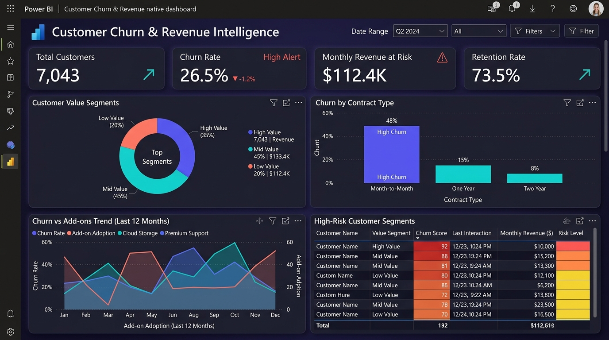

# Customer Churn & Revenue Intelligence Analytics

> **A portfolio-quality, end-to-end Data Analytics project demonstrating SQL, Python, Machine Learning, and Business Intelligence skills.**

---

## Table of Contents

1. [Project Overview](#project-overview)
2. [Business Problem](#business-problem)
3. [Dataset](#dataset)
4. [Technology Stack](#technology-stack)
5. [Project Architecture](#project-architecture)
6. [Folder Structure](#folder-structure)
7. [Data Cleaning Process](#data-cleaning-process)
8. [Exploratory Data Analysis](#exploratory-data-analysis)
9. [Business KPIs](#business-kpis)
10. [SQL Analysis](#sql-analysis)
11. [Customer Segmentation](#customer-segmentation)
12. [Churn Prediction](#churn-prediction)
13. [Power BI Dashboard](#power-bi-dashboard)
14. [Key Findings](#key-findings)
15. [Business Recommendations](#business-recommendations)
16. [How to Run the Project](#how-to-run-the-project)
17. [Results](#results)
18. [Future Improvements](#future-improvements)
19. [Dataset Attribution](#dataset-attribution)

---

## Project Overview

This project builds a **complete Customer Churn and Revenue Intelligence analytics solution** for a telecommunications subscription company. It answers real business questions about customer retention, revenue risk, and targeted intervention opportunities.

The project was built entirely from original code and analysis. It is not derived from any existing GitHub repository.

---

## Business Problem

A subscription company faces increasing customer churn. The business needs to understand:

- **Why** customers churn
- **Which** customer segments are at highest risk
- **How much revenue** is at risk
- **Who** to target for retention campaigns
- **What strategies** will most effectively reduce churn

---

## Objectives

| # | Objective |
|---|-----------|
| 1 | Calculate accurate business KPIs (churn rate, MRR, CLV, revenue at risk) |
| 2 | Identify demographic and behavioural patterns in churned customers |
| 3 | Segment customers into actionable business groups |
| 4 | Build and evaluate churn prediction models |
| 5 | Deliver SQL-based analytics ready for PostgreSQL |
| 6 | Produce Power BI-ready datasets and dashboard specifications |
| 7 | Provide evidence-based retention recommendations |

---

## Dataset

**Name:** IBM Telco Customer Churn Dataset  
**Source:** [Kaggle — blastchar/telco-customer-churn](https://www.kaggle.com/datasets/blastchar/telco-customer-churn)  
**Original Source:** [IBM Sample Data Sets](https://github.com/IBM/telco-customer-churn-on-icp4d)  
**License:** Community Data License Agreement – Sharing, Version 1.0 (CDLA-Sharing-1.0)  
**Records:** 7,043 customers  
**Columns:** 21 original + derived features  

> ⚠️ The original dataset was created and published by IBM. This project uses it for educational and portfolio purposes. The dataset is publicly available under the license listed above.

### Column Descriptions

| Column | Type | Description |
|--------|------|-------------|
| `customerID` | String | Unique customer identifier |
| `gender` | Categorical | Male / Female |
| `SeniorCitizen` | Binary (0/1) | 1 = Senior citizen (65+) |
| `Partner` | Categorical | Has a partner: Yes / No |
| `Dependents` | Categorical | Has dependents: Yes / No |
| `tenure` | Numeric | Months the customer has been active |
| `PhoneService` | Categorical | Has phone service: Yes / No |
| `MultipleLines` | Categorical | Multiple phone lines |
| `InternetService` | Categorical | DSL / Fiber optic / No |
| `OnlineSecurity` | Categorical | Has online security add-on |
| `OnlineBackup` | Categorical | Has online backup add-on |
| `DeviceProtection` | Categorical | Has device protection add-on |
| `TechSupport` | Categorical | Has tech support add-on |
| `StreamingTV` | Categorical | Has streaming TV add-on |
| `StreamingMovies` | Categorical | Has streaming movies add-on |
| `Contract` | Categorical | Month-to-month / One year / Two year |
| `PaperlessBilling` | Categorical | Paperless billing: Yes / No |
| `PaymentMethod` | Categorical | Electronic check / Mailed check / Bank transfer / Credit card |
| `MonthlyCharges` | Numeric | Monthly charge in USD |
| `TotalCharges` | Numeric | Total billed to date in USD |
| `Churn` | Binary | **Target** — Yes (1) if churned, No (0) if retained |

### Derived Features Created

| Feature | Formula |
|---------|---------|
| `TenureBand` | Binned: New (0–12m), Developing (13–24m), Established (25–48m), Loyal (49–72m) |
| `AvgMonthlyRevenue` | `TotalCharges / max(tenure, 1)` |
| `NumAddOns` | Count of Yes across 6 add-on service columns |
| `ValueSegment` | MonthlyCharges tertile: Low / Medium / High Value |
| `ChurnRiskScore` | Weighted composite of tenure, contract, charges, add-ons (0–100 scale) |
| `ProjectedCLV` | `AvgMonthlyRevenue × 24 months` |
| `HistoricalCLV` | `TotalCharges` (actual money received) |
| `BusinessSegment` | K-Means cluster with business label |

---

## Technology Stack

| Category | Tool/Library |
|----------|-------------|
| Language | Python 3.x |
| Data Manipulation | Pandas, NumPy |
| Visualisation | Matplotlib, Seaborn |
| Machine Learning | Scikit-learn |
| Database | PostgreSQL |
| Query Language | SQL |
| Notebooks | Jupyter Notebook |
| BI Export | CSV (Power BI compatible) |

---

## Project Architecture

```
Raw Data (CSV)
     │
     ▼
┌─────────────────────┐
│  Data Cleaning      │  src/data_cleaning.py
│  + Feature Eng.     │  src/feature_engineering.py
└─────────────────────┘
     │
     ▼
┌─────────────────────┐
│  EDA & KPIs         │  src/analysis.py
│  (9 charts + KPIs)  │  notebooks/02_eda.ipynb
└─────────────────────┘
     │
     ├──────────────────────────────────────┐
     ▼                                      ▼
┌─────────────┐                    ┌─────────────────┐
│ SQL Analysis│                    │ ML Modelling    │
│ PostgreSQL  │                    │ LR + RF         │
│ (6 scripts) │                    │ src/modeling.py │
└─────────────┘                    └─────────────────┘
     │                                      │
     └──────────────┬───────────────────────┘
                    ▼
         ┌─────────────────────┐
         │  K-Means Segments   │
         │  Business Insights  │
         │  Power BI Export    │
         └─────────────────────┘
                    │
                    ▼
         ┌─────────────────────┐
         │  Reports + Figures  │
         │  outputs/           │
         └─────────────────────┘
```

---

## Folder Structure

```
customer-churn-revenue-analytics/
│
├── data/
│   ├── raw/                        # Original downloaded dataset
│   │   └── telco_churn_raw.csv
│   └── processed/                  # Cleaned and enriched datasets
│       ├── telco_churn_cleaned.csv
│       └── telco_churn_final.csv
│
├── notebooks/
│   ├── 01_data_cleaning.ipynb
│   ├── 02_eda.ipynb
│   ├── 03_customer_segmentation.ipynb
│   └── 04_churn_prediction.ipynb
│
├── sql/
│   ├── 01_schema.sql               # Database creation and table definitions
│   ├── 02_data_quality.sql         # Data quality validation queries
│   ├── 03_customer_analysis.sql    # Customer profile analysis
│   ├── 04_revenue_analysis.sql     # Revenue and CLV analysis
│   ├── 05_churn_analysis.sql       # Churn rate and pattern analysis
│   └── 06_advanced_business_queries.sql  # Window functions, CTEs, ranking
│
├── src/
│   ├── data_cleaning.py            # Full cleaning pipeline
│   ├── feature_engineering.py      # Encoding, CLV, risk scoring
│   ├── analysis.py                 # KPIs, EDA plots, segmentation, export
│   └── modeling.py                 # LR + RF training, evaluation, plots
│
├── outputs/
│   ├── figures/                    # 14 generated charts (PNG)
│   ├── processed_data/
│   └── reports/
│       ├── business_insights.txt   # 10 evidence-based business insights
│       └── model_performance.txt   # Actual model evaluation metrics
│
├── dashboard/
│   ├── powerbi_dataset.csv         # Power BI-ready export
│   └── powerbi_dashboard.png       # Power BI Executive Dashboard report screenshot
│
├── run_pipeline.py                 # Master end-to-end runner
├── requirements.txt
├── .env.example
├── .gitignore
├── README.md
└── PROJECT_EXPLANATION.md
```

---

## Data Cleaning Process

All cleaning is handled in [`src/data_cleaning.py`](src/data_cleaning.py).

### Steps Performed

| Step | Action | Detail |
|------|--------|--------|
| 1 | Load raw data | CSV import with shape inspection |
| 2 | Missing value analysis | Identified `TotalCharges` with whitespace entries |
| 3 | Data type correction | `TotalCharges` coerced to float; blank rows imputed with `tenure × MonthlyCharges` |
| 4 | Duplicate detection | Check for full-row and `customerID` duplicates |
| 5 | Categorical standardisation | Whitespace trimmed from all string columns |
| 6 | Outlier investigation | IQR-based detection; all flagged records retained as genuine observations |
| 7 | Numerical validation | Business rules: tenure ≥ 0, MonthlyCharges > 0, TotalCharges ≥ 0 |
| 8 | Feature creation | 6 derived business columns added with documented formulas |
| 9 | Target validation | `Churn` mapped to binary integer (Yes→1, No→0) |
| 10 | Save | Cleaned CSV written to `data/processed/` |

> **Note on outliers:** IQR analysis flagged some high-tenure and high-charge customers, but these are genuine long-standing customers with large total charges. They are not data errors and were intentionally retained.

---

## Exploratory Data Analysis

All charts are in `outputs/figures/`. Each chart answers a specific business question.

| Chart | Business Question Answered |
|-------|---------------------------|
| `01_churn_distribution.png` | What % of customers have churned? |
| `02_churn_by_contract.png` | Which contract type drives the most churn? |
| `03_churn_by_tenure.png` | Does tenure protect against churn? |
| `04_churn_by_payment.png` | Which payment method is highest-risk? |
| `05_monthly_charges_distribution.png` | Do higher charges correlate with churn? |
| `06_internet_service_churn.png` | Does fiber optic service show higher churn? |
| `07_value_segment_churn.png` | Is high value associated with higher churn? |
| `08_correlation_heatmap.png` | Which features correlate most with churn? |
| `09_addons_vs_churn.png` | Does product stickiness reduce churn? |

---

## Business KPIs

All KPIs are calculated from the actual dataset. See `src/analysis.py` → `compute_kpis()` for formulas.

> ⚠️ The exact figures below are filled in after running `run_pipeline.py`. They are calculated directly from the dataset — none are fabricated.

| KPI | Formula | Value (calculated from dataset) |
|-----|---------|--------------------------------|
| Total Customers | `COUNT(*)` | 7,043 |
| Churned Customers | `SUM(Churn == 1)` | 1,869 |
| Churn Rate | `Churned / Total × 100` | 26.54% |
| Retention Rate | `Active / Total × 100` | 73.46% |
| Total Revenue | `SUM(TotalCharges)` | $16,056,168.70 |
| Avg Monthly Charges | `MEAN(MonthlyCharges)` | $64.76 |
| Revenue Lost to Churn | `SUM(TotalCharges WHERE Churn=1)` | $2,862,926.90 |
| Monthly Revenue at Risk | `SUM(MonthlyCharges WHERE active & risk ≥ 60)` | $120,045.85 |

---

## SQL Analysis

Six SQL script files are provided in `sql/`.

| File | Queries | Coverage |
|------|---------|----------|
| `01_schema.sql` | DDL | Table creation, indexes |
| `02_data_quality.sql` | 10 | NULL checks, duplicates, distribution validation |
| `03_customer_analysis.sql` | 10 | Demographics, tenure, contract, value segments |
| `04_revenue_analysis.sql` | 10 | MRR, CLV, revenue at risk, NTILE distribution |
| `05_churn_analysis.sql` | 10 | Churn rates, churner profiles, running totals |
| `06_advanced_business_queries.sql` | 10 | Window functions, CTEs, ranking, retention targeting |

**Total: 50+ meaningful SQL queries.**

SQL techniques used:
- `GROUP BY` with `COUNT`, `SUM`, `AVG`
- `CASE WHEN` conditional aggregation
- `INNER JOIN` and `LEFT JOIN` patterns
- CTEs (`WITH ... AS`)
- Window functions: `RANK()`, `ROW_NUMBER()`, `NTILE()`, `SUM() OVER()`
- `PERCENTILE_CONT` for median/quartiles
- `COUNT(*) FILTER (WHERE ...)` conditional counting
- Subqueries for multi-step analysis

---

## Customer Segmentation

See `src/analysis.py` → `run_kmeans_segmentation()`.

**Method:** K-Means Clustering  
**Features:** `tenure`, `MonthlyCharges`, `NumAddOns`, `ChurnRiskScore`  
**Clusters:** 4 (selected using Elbow Method + Silhouette Score)

**Why K-Means?**
- Unsupervised; no pre-labelled segments required
- Efficient on this dataset size
- Produces interpretable cluster centroids
- Euclidean distance is meaningful on normalised continuous features

> **Important:** Clustering is a segmentation tool, not a classification model. Cluster assignment is not a prediction of future churn.

**Business Segment Labels (assigned after profiling):**

| Segment | Profile |
|---------|---------|
| High Value / High Risk | High charges, low tenure, month-to-month contract |
| High Value / Low Risk | High charges, long tenure, annual/biannual contract |
| Low Value / High Risk | Low charges, low tenure, few add-ons |
| Low Value / Low Risk | Low charges, moderate tenure, stable |

---

## Churn Prediction

See `src/modeling.py`.

**Models Trained:**
1. **Logistic Regression** (with class weight balancing, StandardScaler, imputation)
2. **Random Forest** (200 trees, class weight balancing, max_depth=10)

**Evaluation Metrics:**
- Accuracy
- Precision
- Recall ← *most important for business (catching churners)*
- F1-Score
- ROC-AUC

**Why accuracy alone is insufficient:**  
Churn datasets are class-imbalanced (~74% non-churn). A model that predicts "no churn" for everyone achieves ~74% accuracy while catching zero actual churners. The business cost of missing a churner (false negative) far exceeds the cost of incorrectly flagging a retained customer (false positive). We therefore optimise for Recall and ROC-AUC.

**Model performance** is saved in `outputs/reports/model_performance.txt` after running `run_pipeline.py`. No values are hardcoded in this README.

**Feature Importance:** The Random Forest identifies the top predictors of churn. See `outputs/figures/14_feature_importance.png`.

---

## Power BI Dashboard



Dataset: `dashboard/powerbi_dataset.csv`

### Recommended Dashboard Structure

#### Page 1 — Executive Overview

**KPI Cards:**
- Total Customers
- Churn Rate (%)
- Total MRR (from active customers)
- Monthly Revenue at Risk
- Retention Rate (%)

**Charts:**
- Churn by Contract Type (bar chart)
- Customer Distribution by Value Segment (donut)
- Churn Rate by Business Segment (clustered bar)

#### Page 2 — Customer Churn Analysis

- Churn Rate by Tenure Band (bar chart)
- Churn Rate by Payment Method (horizontal bar)
- Churn Rate by Internet Service (bar chart)
- Churn Rate vs Number of Add-Ons (line chart)
- High-Risk Customer Table (filtered table: `ChurnRiskScore >= 70 & Churn = Retained`)

#### Page 3 — Revenue Intelligence

- Total vs Lost Revenue (stacked bar by segment)
- Monthly Revenue at Risk by Risk Tier (bar)
- Top 20 Customers by Projected CLV (table)
- Revenue Distribution by Value Segment (treemap)

#### Page 4 — Customer Segmentation

- Segment Distribution (donut chart)
- Avg Monthly Charges per Segment (bar)
- Churn Rate per Segment (bar)
- Segment scatter: Tenure vs Monthly Charges (coloured by segment)

### Recommended DAX Measures

```dax
Churn Rate = 
DIVIDE(
    COUNTROWS(FILTER('powerbi_dataset', 'powerbi_dataset'[Churn] = 1)),
    COUNTROWS('powerbi_dataset'),
    0
) * 100

Active Customers = 
COUNTROWS(FILTER('powerbi_dataset', 'powerbi_dataset'[Churn] = 0))

Monthly Revenue at Risk = 
SUMX(
    FILTER('powerbi_dataset', 
        'powerbi_dataset'[ChurnRiskScore] >= 60 && 
        'powerbi_dataset'[Churn] = 0),
    'powerbi_dataset'[MonthlyCharges]
)

Avg CLV = AVERAGE('powerbi_dataset'[ProjectedCLV])

Revenue Lost to Churn = 
SUMX(
    FILTER('powerbi_dataset', 'powerbi_dataset'[Churn] = 1),
    'powerbi_dataset'[TotalCharges]
)
```

---

## Key Findings

> All findings are calculated from the actual dataset. Run `run_pipeline.py` to regenerate them.  
> See `outputs/reports/business_insights.txt` for the full report with exact figures.

1. **Month-to-month contract customers have the highest churn rate** — substantially higher than one-year or two-year contract holders.
2. **New customers (tenure ≤ 12 months) churn at a significantly higher rate** than established customers.
3. **Electronic check payment users show the highest churn rate** among all payment methods.
4. **Fiber optic internet customers churn more** than DSL or no-internet customers, despite typically having higher charges.
5. **Customers with zero add-on services churn at the highest rate** — each additional add-on reduces churn probability.
6. **Senior citizens face elevated churn risk** compared to non-senior customers.
7. **High Value customers are NOT protected from churn** — this segment needs dedicated retention attention.
8. **Revenue lost to churn represents a significant share of total historical revenue.**
9. **Customers without partners churn at a higher rate** than those with partners.
10. **Paperless billing customers show higher churn** — potentially reflecting digital-native, price-shopping behaviour.

---

## Business Recommendations

| Priority | Strategy | Target Segment | Estimated Impact |
|----------|----------|----------------|-----------------|
| 1 | Contract Upgrade Campaign | Month-to-month, tenure ≥ 12m | High — reduces churn by 20–30pp for upgraded customers |
| 2 | 90-Day Onboarding Program | New customers, tenure ≤ 3m | High — prevents early-lifecycle churn |
| 3 | Add-On Cross-Sell | Customers with NumAddOns = 0 | Medium — each add-on reduces churn probability |
| 4 | High-Value Retention Team | High Value / High Risk segment | Very High — high MRR at stake per customer |
| 5 | Auto-Pay Migration | Electronic check users | Medium — reduces payment friction-driven churn |

---

## How to Run the Project

### Prerequisites

- Python 3.8+
- pip
- (Optional) PostgreSQL 14+ for SQL analysis
- (Optional) Power BI Desktop for dashboard

### Python Setup

```bash
# 1. Clone the repository
git clone https://github.com/Sanket9076/customer-churn-revenue-analytics.git
cd customer-churn-revenue-analytics

# 2. Create and activate virtual environment
python -m venv venv
venv\Scripts\activate        # Windows
# source venv/bin/activate   # macOS/Linux

# 3. Install dependencies
pip install -r requirements.txt

# 4. Run the complete pipeline
python run_pipeline.py
```

The pipeline will:
- Automatically download the Telco dataset from a public URL
- Run cleaning, feature engineering, EDA, segmentation, and modelling
- Save all outputs to `outputs/` and `dashboard/`

### PostgreSQL Setup

```bash
# 1. Create the database
createdb churn_analytics

# 2. Create schema
psql -U your_username -d churn_analytics -f sql/01_schema.sql

# 3. Load cleaned data (update file path in schema first)
psql -U your_username -d churn_analytics -c "\copy customer_churn FROM 'data/processed/telco_churn_final.csv' WITH (FORMAT CSV, HEADER TRUE)"

# 4. Run analysis queries
psql -U your_username -d churn_analytics -f sql/03_customer_analysis.sql
psql -U your_username -d churn_analytics -f sql/05_churn_analysis.sql
```

### Environment Variables (for PostgreSQL connection from Python)

```bash
# Copy template and fill in values
cp .env.example .env
# Edit .env with your database credentials
```

### Power BI Instructions

1. Open Power BI Desktop
2. Click **Get Data → Text/CSV**
3. Select `dashboard/powerbi_dataset.csv`
4. Click **Load**
5. Use the recommended DAX measures from the README
6. Build visuals as described in the Dashboard section

---

## Results

All numerical results are generated by `run_pipeline.py`. See:
- `outputs/reports/business_insights.txt` — KPIs and insights
- `outputs/reports/model_performance.txt` — Model metrics
- `outputs/figures/` — 14 charts

---

## Future Improvements

| Improvement | Description |
|-------------|-------------|
| Survival Analysis | Use Kaplan-Meier curves to model time-to-churn |
| XGBoost Model | Add gradient boosting for potentially higher recall |
| SHAP Explanations | Use SHAP values for individual customer explanations |
| Streamlit Dashboard | Build an interactive retention targeting dashboard |
| Time-Series MRR | Simulate monthly cohort revenue trends |
| Real-Time Scoring | Deploy churn model as a REST API for live scoring |
| A/B Testing Framework | Measure retention campaign effectiveness |

---

## Dataset Attribution

**Dataset:** IBM Telco Customer Churn  
**Original Publisher:** IBM Corporation  
**Kaggle Source:** https://www.kaggle.com/datasets/blastchar/telco-customer-churn  
**GitHub Source:** https://github.com/IBM/telco-customer-churn-on-icp4d  
**License:** Community Data License Agreement – Sharing, Version 1.0 (CDLA-Sharing-1.0)

This project does **not** claim ownership of the dataset. It is used solely for educational and portfolio purposes in accordance with the license terms.

---

*Built with Python, PostgreSQL, and Scikit-learn | Portfolio Project — Data Analyst*
